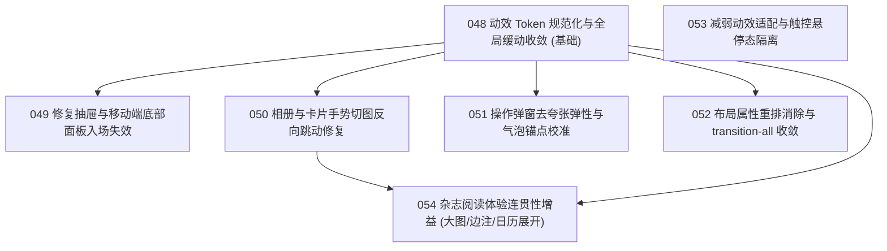

# 动画与手势交互系统重构施工索引 (Animation Plans Index)

本目录记录 Orbit 动效交互重构施工计划。遵循 [Emil Kowalski 的设计工程哲学](file:///Users/sunyuan/Desktop/project/orbit/.agents/skills/review-animations/STANDARDS.md) 与 Orbit [DESIGN.md](file:///Users/sunyuan/Desktop/project/orbit/DESIGN.md)「刊物文学温度、克制留白、拒绝装饰性动效胶水」原则。

## 计划全景与执行状态

| 编号 | 计划文件 | 严重级 | 分类 | 状态 | 依赖 |
|---|---|---|---|---|---|
| **048** | [048-animation-tokens-and-easing.md](048-animation-tokens-and-easing.md) | MEDIUM | 7. Cohesion & tokens | DONE | 无（基石） |
| **049** | [049-drawer-and-bottomsheet-entrance.md](049-drawer-and-bottomsheet-entrance.md) | HIGH | 1. Purpose & frequency | DONE | 048 |
| **050** | [050-gesture-swipe-physicality.md](050-gesture-swipe-physicality.md) | HIGH | 3. Physicality & origin | DONE | 048 |
| **051** | [051-action-sheet-and-popover-origin.md](051-action-sheet-and-popover-origin.md) | HIGH | 3. Physicality & origin | DONE | 048 |
| **052** | [052-motion-reflow-and-transition-all.md](052-motion-reflow-and-transition-all.md) | HIGH | 5. Performance | DONE | 048 |
| **053** | [053-reduced-motion-and-touch-hover.md](053-reduced-motion-and-touch-hover.md) | MEDIUM | 6. Accessibility | DONE | 无 |
| **054** | [054-editorial-continuity-reveal-polish.md](054-editorial-continuity-reveal-polish.md) | LOW | 8. Missed opportunities | DONE | 048, 050 |

---

## 推荐执行顺序

1. **第一阶段（基石）**：执行 **048**。确立统一的全局 `--motion-ease` Token，根除带弹跳的废弃贝塞尔曲线，为后续计划提供唯一真源；
2. **第二阶段（高危体感与手势修复）**：并行或顺次执行 **049**、**050**、**051**。恢复抽屉平滑滑入、彻底解决相册切图反向跳变物理反常、抹平确认弹窗的 56% 卡通弹性；
3. **第三阶段（性能与无障碍合规）**：执行 **052**、**053**。根除 AI 悬浮球与打字框的 Reflow 重排、收敛 `transition: all`、完善低动效减弱与移动端触控隔离；
4. **第四阶段（杂志感精致体验）**：执行 **054**。为相簿大图展开、选区边注输入框添加温润的微展开动效，达到刊物级细腻质感。
